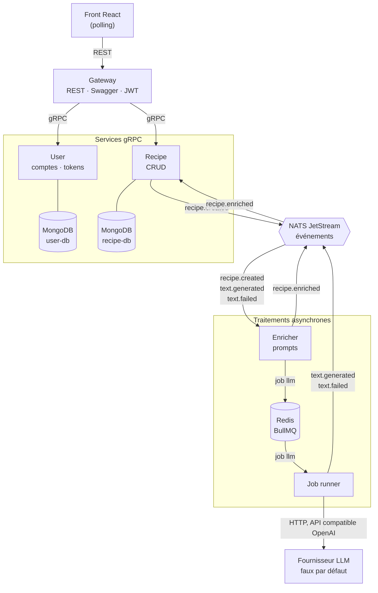

# Architecture

Une recette publiée est **enrichie en arrière-plan** : un LLM rédige sa description. Le front ne parle qu'à la gateway, et interroge la recette jusqu'à ce que son statut quitte `pending`.

## Applications

| App            | Rôle                                                                                    | Données     | Interface                     |
| -------------- | --------------------------------------------------------------------------------------- | ----------- | ----------------------------- |
| `gateway`      | point d'entrée unique : validation, vérification du JWT, composition recettes + auteurs | aucune      | REST, Swagger sur `/docs`     |
| `user`         | comptes, mots de passe (argon2id), signature des JWT                                    | `user-db`   | gRPC                          |
| `recipe`       | recettes et statut d'enrichissement                                                     | `recipe-db` | gRPC                          |
| `enricher`     | transforme une recette en job LLM, puis le résultat en enrichissement                   | aucune      | événements, producteur BullMQ |
| `job-runner`   | exécute les jobs LLM, avec retries                                                      | aucune      | worker BullMQ                 |
| `fake-llm-api` | faux fournisseur LLM (voir [llm-provider.md](llm-provider.md))                          | aucune      | HTTP                          |
| `front`        | interface React                                                                         | aucune      | navigateur                    |

## Communication

| Mécanisme                     | Quand                                                   | Où                                                       |
| ----------------------------- | ------------------------------------------------------- | -------------------------------------------------------- |
| **REST**                      | l'API publique, consommée par le front                  | gateway                                                  |
| **gRPC**                      | une réponse est attendue tout de suite                  | gateway vers user et recipe (`packages/contracts/proto`) |
| **Événements NATS JetStream** | un fait à diffuser aux services intéressés              | `packages/contracts/src/events.ts`                       |
| **Jobs BullMQ**               | une tâche longue, exécutée une seule fois, avec retries | file `llm`, `packages/contracts/src/jobs.ts`             |

### Événements

| Sujet                            | Émetteur   | Consommateur |
| -------------------------------- | ---------- | ------------ |
| `recipe.created`                 | recipe     | enricher     |
| `text.generated` / `text.failed` | job-runner | enricher     |
| `recipe.enriched`                | enricher   | recipe       |

Chaque service consomme avec un consumer durable, partagé par toutes ses instances : un événement survit à l'arrêt du service, et n'est traité que par une instance.

### File de jobs `llm`

- **Producteur** : l'enricher, avec l'id de la recette dans les données du job.
- **Worker** : le job runner. Il fait 3 tentatives, avec un backoff exponentiel (options du job dans `packages/contracts/src/jobs.ts`).
- **Résultat** : publié en événement, `text.generated` ou, après la dernière tentative, `text.failed`.

## Données

**Une base par service qui stocke des données** : chaque service a sa propre instance MongoDB, et aucun autre service ne s'y connecte. Les données d'un autre service s'obtiennent par son API (la gateway compose recettes et auteurs) ou par les événements (l'enricher reçoit le contenu de la recette dans `recipe.created`).

| Base        | Collection | Index          |
| ----------- | ---------- | -------------- |
| `user-db`   | `users`    | `email` unique |
| `recipe-db` | `recipes`  | `ownerId`      |

## Authentification

1. Le user service vérifie le mot de passe et signe un **JWT HS256** avec `JWT_SECRET`. Les claims portent `sub`, `email` et `name`.
2. Le front l'envoie dans `Authorization: Bearer <token>`.
3. La gateway vérifie la signature et l'expiration avec **le même secret**, sans appeler le user service : la vérification est sans état.
4. L'identité part vers les services dans la metadata gRPC `x-user-id`.
